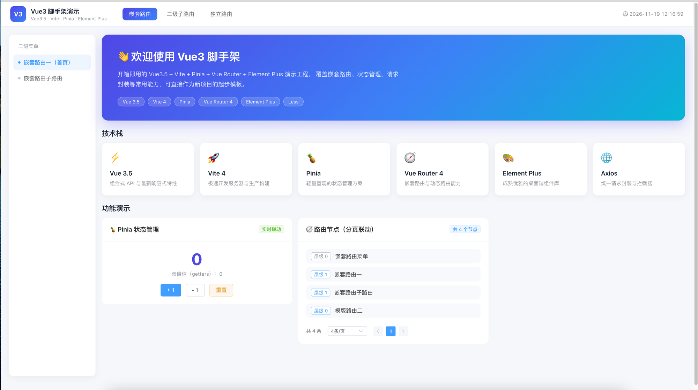

# Vue3 脚手架模板



开箱即用的 Vue3 前端起步模板，覆盖嵌套路由、状态管理、请求封装等常用能力，可直接作为新项目的起步脚手架。

## 核心版本

| 依赖 | 版本 | 说明 |
| --- | --- | --- |
| vue | 3.5.45 | 核心框架（组合式 API） |
| vue-router | 4.6.5 | 官方路由（Hash 模式） |
| pinia | 2.3.1 | 轻量状态管理 |
| element-plus | 2.14.8 | 桌面端组件库（中文语言包） |
| axios | 1.21.1 | HTTP 请求（统一封装 + 拦截器） |
| vite | 4.5.14 | 构建工具 |
| @vitejs/plugin-vue | 4.6.2 | Vue 单文件组件编译插件 |
| @vitejs/plugin-vue-jsx | 4.2.0 | JSX 语法支持 |
| less / less-loader | 4.9.1 / 11.1.4 | Less 样式预处理 |
| unplugin-auto-import | 0.16.7 | API 按需自动导入 |
| unplugin-vue-components | 0.25.2 | 组件（Element Plus）按需自动导入 |

## 环境要求

- Node.js >= 16（推荐 18 / 20 / 22）
- 包管理器推荐 [pnpm](https://pnpm.io/)（项目自带 pnpm-lock.yaml）

## 快速开始

```bash
# 1. 安装依赖（执行目录：项目根目录）
pnpm install

# 2. 启动开发服务（默认端口 5005）
pnpm run dev

# 3. 浏览器访问（Hash 路由）
# http://localhost:5005/#/template/template1
```

## 常用命令

| 命令 | 说明 |
| --- | --- |
| `pnpm run dev` | 启动开发服务（热更新，端口 5005） |
| `pnpm run build` | 生产构建（产物输出到 dist/） |
| `pnpm run preview` | 本地预览构建产物 |

## 目录结构

```
├── index.html                 # 应用入口 HTML
├── vite.config.js             # Vite 配置（插件、@ 别名、构建产物规则）
├── pnpm-workspace.yaml        # pnpm 12 构建脚本放行配置（esbuild / vue-demi）
├── docs/                      # 文档与截图
└── src/
    ├── main.js                # 应用入口（挂载路由、状态管理）
    ├── App.vue                # 根组件（Element Plus 中文语言包）
    ├── api/                   # 接口定义
    ├── router/index.js        # 路由配置（含动态浏览器标题）
    ├── store/                 # Pinia 仓库
    │   ├── index.js           # Pinia 实例
    │   ├── routes.js          # 路由表仓库
    │   └── demo.js            # 计数器演示仓库（state/getters/actions 范例）
    ├── utils/request.js       # Axios 实例与拦截器（统一错误提示）
    ├── views/                 # 页面组件
    │   ├── layout.vue         # 顶部导航布局（品牌 + 菜单 + 实时时钟）
    │   ├── template-layer.vue # 二级菜单侧边栏（嵌套路由容器）
    │   ├── template.vue       # 首页（欢迎横幅 + 技术栈 + 功能演示）
    │   ├── template2.vue      # 独立路由页（Axios 请求演示）
    │   └── template-child.vue # 嵌套路由子路由页
    ├── style.css              # 全局样式（CSS 变量 / 浅色主题）
    └── style.less             # 全局 Less 样式入口
```

## 演示功能说明

- **嵌套路由**：顶部导航 + 二级侧边菜单，菜单与路由精确联动高亮
- **Pinia 状态管理**：首页计数器演示 state / getters / actions 标准写法
- **路由节点分页**：首页展示路由表节点，分页器与列表真实联动
- **Axios 请求封装**：独立路由页手动触发请求，展示 loading 与结果（拦截器见 `src/utils/request.js`）
- **实时时钟**：顶部栏每秒刷新，演示定时器的创建与卸载清理

## 作为起步模板使用

1. **获取模板**：clone 或复制本项目到本地
2. **安装依赖**：`pnpm install`（首次安装会自动放行 esbuild / vue-demi 的构建脚本）
3. **新增页面**：在 `src/views/` 新建 `.vue` 文件，再到 `src/router/index.js` 添加路由
   - `meta.name`：路由名称（展示在首页节点列表与浏览器标题）
   - `meta.level`：层级（用于菜单分级展示）
   - `meta.node`：是否为叶子节点（首页节点列表筛选标记）
4. **新增菜单**：顶部导航改 `src/views/layout.vue` 的 `navList`，二级菜单改 `src/views/template-layer.vue` 的 `menuList`
5. **新增接口**：在 `src/api/` 中定义函数，统一使用 `@/utils/request` 实例发起请求
6. **新增状态**：仿照 `src/store/demo.js` 用 `defineStore` 定义仓库
7. **个性化**：品牌名与导航改 `layout.vue`；主题色改 `src/style.css` 的 CSS 变量
8. **构建发布**：`pnpm run build`，将 `dist/` 产物部署到静态服务器

## 常用配置

| 配置项 | 位置 | 说明 |
| --- | --- | --- |
| 路径别名 `@` | vite.config.js | 指向 src 目录 |
| 开发端口 5005 | vite.config.js（server.port） | 可按需修改 |
| 请求 baseURL | `.env` 中 `VITE_TINTMCE_BASE_URL` | 注入 `src/utils/request.js` |
| 构建产物规则 | vite.config.js（build.rollupOptions） | js/css 输出目录与文件名 |
| 浏览器标题 | src/router/index.js（afterEach） | 根据路由 meta.name 自动生成 |
